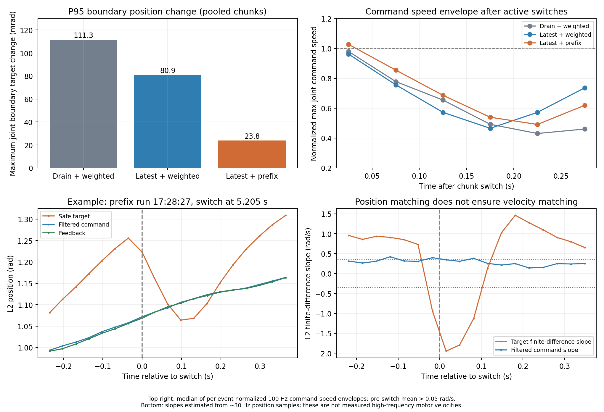

# 2026-11-13 EDULITE 队列更新与局部拟合三组对照

> 已合并至[真机部署调整总报告](EDULITE_DEPLOYMENT_COMPARISON_2026-11-13.md)，统一比较5种方案、15轮测试。本文件保留阶段记录，当前结论与参数选择以总报告为准。

## 数据与可比性

所有文件位于 `robot/edulite_a3_vla/` 下：

- 基准：`inference_outputs_multitask/run_20261113_161246`、`161333`、`161414`，drain_queue＋weighted_history。
- latest：`inference_outputs_multitask_latest/run_20261113_172501`、`172546`、`172628`，latest_ready＋weighted_history。
- prefix：`inference_outputs_multitask_adapolicy/run_20261113_172742`、`172827`、`172909`，latest_ready＋prefix_refit。

均为place_red_block_into_box、同一epoch50 checkpoint、归一化统计、32步预测/16步装入、预取8步、
30Hz目标更新、100Hz控制、相同安全参数。基准的instruction显示文本与新组不同，但实际task_name相同；
该模型不编码instruction，任务由task_name选取的任务向量决定。
新组增加了显式method/mode元数据，实际算法差异如上。局部拟合使用前三控制点、正则0.05、历史2步。

每组3轮；没有相同初始状态的严格配对，也没有保存任务成功标签。
停止原因是operator_stop，运行时长不能当作任务完成时间。
以下P95由原始CSV样本合并后计算，不是对各轮P95求平均；动作块指标排除了preview首块。

## 总体比较

| 指标 | 基准 | latest | prefix |
|---|---:|---:|---:|
| 后台动作块数量 | 171 | 224 | 224 |
| 平滑输出边界跳变P95(rad) | 0.111315 | 0.080896 | 0.023757 |
| 每块最大目标步长P95(rad)，含边界 | 0.123253 | 0.087255 | 0.048788 |
| 块首状态观测年龄中位数(ms) | 301.61 | 203.09 | 203.17 |
| 块首状态观测年龄P95(ms) | 302.99 | 236.28 | 236.20 |
| 推理P95(ms) | 206.84 | 211.01 | 206.27 |
| 样条计算P95(ms) | 未记录 | 0.392 | 0.776 |
| 队列等待/调度重置 | 0/0 | 0/0 | 0/0 |
| 样条回退后台块 | 4/171 | 6/224 | 3/224 |
| 跟踪误差P95(rad)：发送指令与反馈 | 0.017349 | 0.017338 | 0.017460 |
| 有安全处理警告的目标比例 | 3.78% | 1.40% | 0% |
| 模型安全目标与滤波发送指令之差P95(rad) | 0.138746 | 0.109325 | 0.129260 |

latest相对基准降低边界跳变P95约27.3%；prefix相对latest再降低约70.6%，相对基准降低约78.7%。
这些是目标衔接指标，不代表实际反馈速度/jerk按相同比例改善。
prefix的跟踪误差基本不变，且模型目标与滤波指令的距离没有优于latest。

latest和prefix在未被人工停止截断的后台块中，取出目标数的中位数均为13，P95为14，
即典型切换周期约13/30=0.433秒。新结果替换了旧尾部，没有观察到断供。
三个prefix轮次正式动作执行期间的模型指令超时和调度重置都为0；17:28:27的原始摘要另有1个启动前超时周期。
拟合CPU耗时不到1ms的P95不足以解释周期性停顿。

## 新模式各轮结果

| 模式/时间 | 后台块 | 输出边界跳变P95(rad) | 观测年龄中位数(ms) | 跟踪误差P95(rad) | 回退 |
|---|---:|---:|---:|---:|---:|
| latest 17:25:01 | 75 | 0.083559 | 202.92 | 0.016045 | 2 |
| latest 17:25:46 | 61 | 0.079415 | 203.08 | 0.016857 | 2 |
| latest 17:26:28 | 88 | 0.071590 | 203.33 | 0.018498 | 2 |
| prefix 17:27:42 | 77 | 0.025736 | 203.19 | 0.016707 | 1 |
| prefix 17:28:27 | 67 | 0.024235 | 203.13 | 0.017356 | 1 |
| prefix 17:29:09 | 80 | 0.022874 | 203.07 | 0.018107 | 1 |

## 为什么仍会有chunk边界的顿挫

### 1. 小的位置跳变不等于速度方向连续

从execution_trace.csv的safe_target计算目标序列差分斜率，用runtime_ticks.csv的command_mono_s作为时间。
每个边界前两个目标间隔与边界后两个目标间隔分别取平均六维斜率向量。
仅在两向量的最大分量都超过0.05rad/s时计算方向夹角，避免静止噪声主导。

| 目标方向诊断 | 基准 | latest | prefix |
|---|---:|---:|---:|
| 有效边界数量 | 162 | 201 | 191 |
| 前后目标斜率向量点积小于0的边界 | 156 (96.3%) | 192 (95.5%) | 183 (95.8%) |
| 对照：同一chunk内部的方向反转比例 | 20.7% | 24.0% | 37.8% |

这说明重规划时目标序列经常折返，当前局部拟合没有消除该现象。
这不是电机实际反转比例，也不能作为任务成功率。目标是定位量，差分斜率并不是显式发送的速度指令。

典型例子：prefix的17:28:27轮，第156行附近（t约5.205秒），L2目标斜率由约+0.789变为-1.871rad/s，
边界最大关节目标变化仅0.033811rad。边界前模型目标与滤波发送指令已相差约0.198rad。
滤波后的发送位置和反馈仍大体同向前进，但速度下降，随后又加速，形成视觉上的犹豫。
所列斜率由约30Hz异步快照差分估计，不能当成精确的高频速度，特别不能用它判断电机超速。

### 2. 跟踪误差小，可能只是电机很好地跟随了较慢的滤波指令

following_error记录的是filtered_command与feedback，而不是模型目标与feedback。
prefix的前者P95约0.01746rad，但模型safe_target与filtered_command的差距P95仍约0.12926rad。
仅看following_error会遗漏规划目标领先于当前发送轨迹的问题。

当前样条history来自已取出的模型目标，没有使用100Hz滤波状态的位置/速度作为边界条件。
因此贴合历史模型目标，不保证接上当前正在执行的运动状态。
原有100Hz滤波器不会在每个chunk处重置速度；顿挫不应解释为代码每块主动归零速度。
该滤波器持续运行，但目标折返、速度/加速度限幅会让其减速，再随新目标加速。

### 3. 新预测仍有时延，也没有显式速度/加速度连续约束

新模式块首观测年龄中位数已降到约203ms，约为6个30Hz动作周期，但新轨迹仍从第0步执行，
没有时间对齐/延迟步数补偿。这与规划/执行状态差异共同构成目标折返的合理解释，
现有日志不能把其影响与模型自身预测变化、初始摆放、控制滤波影响完全分离。
局部拟合只对历史位置做软拟合，并不硬性满足切换点速度或加速度一致。

## 100Hz指令速度在边界后确实有下降

对控制日志max_command_velocity_rad_s做事件对齐：取边界前100～20ms的均值作为基准，
仅保留该均值大于0.05rad/s的运动边界。边界后按50ms分箱，并在每个事件归一化后取中位数。

| 边界后的时段 | 基准 | latest | prefix |
|---|---:|---:|---:|
| 0～50ms | 0.98 | 0.96 | 1.03 |
| 50～100ms | 0.78 | 0.76 | 0.85 |
| 100～150ms | 0.65 | 0.57 | 0.69 |
| 150～200ms | 0.49 | 0.47 | 0.54 |
| 200～250ms | 0.43 | 0.57 | 0.49 |
| 250～300ms | 0.46 | 0.74 | 0.62 |

有效边界基准147个、latest182个、prefix182个。prefix减轻了早期减速，但并未消除速度下凹。
边界后150ms内，指令速度包络最低值下降到前基准一半以下的事件比例为54.4%、58.2%、43.4%。
这里是控制器计算的最大关节指令速度包络，不是实测电机速度；自然任务转弯也可导致减速，
该统计支持边界处周期性减速现象，但不是对顿挫来源的完整因果证明。

图底部是说明性案例，不是全体轨迹的平均；顶部曲线是事件级归一化后的中位数，没有把边界当作独立任务试验做显著性检验。
合并统计JSON见 [analysis/edulite_async_prefix_comparison_2026-11-13.json](analysis/edulite_async_prefix_comparison_2026-11-13.json)。

## 后续建议

1. 暂时保留latest_ready和现有2/8/4参数，确认局部拟合不损害成功率/放置精度。
2. 下一轮优先改进边界条件：记录100Hz滤波状态的关节位置/速度向量，并让新轨迹接上正在发送的状态；
   将规划目标历史、safe_target和滤波状态分开，不能把它们混称为“已执行轨迹”。
3. 再对比显式的位置/速度约束桥接，或在100Hz时刻连续求值轨迹及其导数；保留原速度、加速度保护。
4. 单独研究带时间戳的轨迹对齐，不能只裁掉过期动作而忽略新的切换连续性与夹爪事件。
5. 当前没有证据要求继续增大预取阈值；也不建议把滤波omega从10继续往下调来压顿挫，
   因为更强的低通可能增大目标与指令之间的滞后。先处理目标方向与速度衔接。

本次仅分析记录、生成报告和图表，没有修改运行控制代码或连接机械臂。
