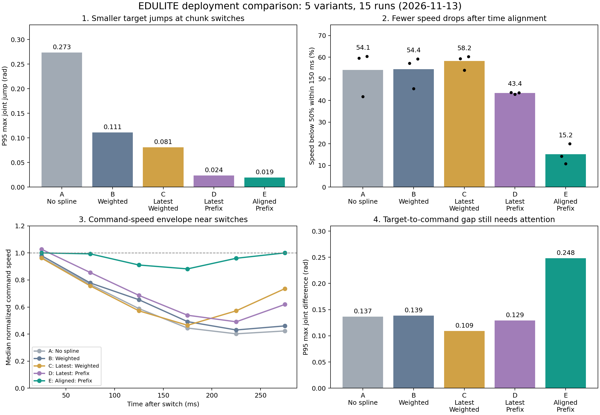

# EDULITE 真机部署调整总报告：B样条、异步接入与时间对齐

日期：2026-11-13。合并此前三份阶段报告，按实际测试顺序比较5种方案、15轮记录。
重叠使用的整体样条基准组只计一次，共915个后台动作块、13006次模型目标更新。

这几轮调整呈现出两个不同层面的改善：开启样条、改用就绪即替换、再改局部拟合，逐步降低了目标位置的边界跳变；
最后加入时间对齐，换块后的指令速度下降才明显减少，与现场“顿挫明显改善”的反馈一致。
当前保留E方案及现有参数；模型目标与滤波发送位置的距离仍较大，日志也尚不能用于计算任务成功率。

## 1. 五种方案分别改变了什么

**五组均使用异步后台预取。** C组改变的是新结果的接入策略，不是从同步推理切换到异步推理。
下面的“16步”指每次接入的窗口容量；就绪即替换时，窗口可能尚未执行完就被下一份预测替换。

| 组别 | 方案 | 新结果如何接入 | B样条处理 | 接入窗口 |
|---|---|---|---|---|
| A | 未开样条 | `drain_queue`：旧队列耗尽后接入 | 关闭，仍有原100Hz控制滤波与限速 | 固定预测`[0:16]` |
| B | 整体加权样条 | `drain_queue` | `weighted_history`：历史2点与新16点一起拟合 | 固定`[0:16]` |
| C | 就绪即替换＋整体样条 | `latest_ready`：结果就绪即替换旧尾部 | 同B | 固定`[0:16]` |
| D | 就绪即替换＋局部拟合 | 同C | `prefix_refit`：先拟合新16点，再用历史2点调整前3个控制点 | 固定`[0:16]` |
| E | 局部拟合＋时间对齐，当前方案 | 同C | 同D，先选时间窗口再拟合 | `[d:d+16]`，d由本次观测年龄计算 |

对应配置位于 `robot/edulite_a3_vla/`：

| 组别 | 配置对应关系 |
|---|---|
| A | `config.real_multitask.yaml`的历史关闭样条状态，`joint_bspline.enabled=false` |
| B | `config.real_multitask.yaml`，开启整体样条 |
| C | `config.real_multitask_latest.yaml` |
| D | `config.real_multitask_adapolicy.yaml` |
| E | `config.real_multitask_adapolicy_aligned.yaml` |

表中方案依据每轮日志保存的settings，而非文件当前内容。A、B日志没有显式method/mode字段，按当时实现对应默认的
weighted_history/drain_queue。D、E是项目内的AdaPolicy风格局部拟合实现，不应当作论文官方部署的完整复现。

## 2. 共同条件与可比性

- 测试任务均为入盒：`place_red_block_into_box`；不能直接据此推断叠蓝块任务的效果。
- 同一多任务epoch50模型：`checkpoints_vla/edulite_single_multitask/sft_2026-10-31_17-48-32/checkpoint_epoch_50.pt`。
- 同一统计文件：`utils/stat-edulite-single-multitask.json`，模型device=cuda、dtype=bfloat16。
- 每次模型预测32步，接入窗口16步，推理采样10步；目标更新30Hz，控制100Hz，预取阈值为队列剩余8步。
- 所有开启样条组都使用三次样条、8个控制点、历史2点、历史权重4、`fallback_if_worse=true`。
- D、E另外使用前3个自由控制点、正则系数0.05。E增加时间对齐和启动首块刷新。
- 安全配置完全一致：filter_omega=10、最大速度L1～L3为0.35rad/s、L4～L6为0.45rad/s，
  最大加速度分别1.2/1.8rad/s²，目标步长上限分别0.08/0.10rad，机械边界余量0.03rad。

脚本已核对各组内settings一致、各组间上述模型与安全参数一致。
A/B的instruction显示文本曾写成叠蓝块，但task_name均为入盒；当前模型通过task_name加载任务向量，instruction不编码为模型条件。
E与D的控制设置差异只有时间对齐开关及其元数据；开关同时改变了启动首块来源，因此该对照包含启动刷新行为。

每组只有3轮，没有相同初始状态的严格配对或随机化。全部停止原因为operator_stop，没有保存成功/失败标签。
各轮运行时长和手动停止时机不同，**不能把记录时长视作任务完成时间，也不能把块数或减速事件当作独立任务试验**。

## 3. 五组合并结果

除另有说明，P50/P95均由每组3轮的原始CSV样本合并计算，不是对各轮分位数求平均。
块级指标仅取source=background，排除preview/startup_refresh；跟踪误差取保存的100Hz控制样本，
目标到发送位置的距离与警告比例取全部模型目标更新，包括首块。

### 3.1 目标衔接与换块减速

| 指标 | A 未开样条 | B 整体样条 | C 就绪替换 | D 局部拟合 | E 时间对齐 |
|---|---:|---:|---:|---:|---:|
| 后台块数 | 158 | 171 | 224 | 224 | 138 |
| 模型目标更新数，含首块 | 2547 | 2776 | 2934 | 2917 | 1832 |
| 输出边界跳变P50(rad) | 0.119141 | 0.040304 | 0.027342 | 0.007931 | 0.006279 |
| 输出边界跳变P95(rad) | 0.273438 | 0.111315 | 0.080896 | 0.023757 | 0.019407 |
| 输出边界跳变最大值(rad) | 0.343750 | 0.151493 | 0.102700 | 0.033811 | 0.037714 |
| 每块最大目标步长P95，含边界(rad) | 未记录 | 0.123253 | 0.087255 | 0.048788 | 0.042692 |
| 换块后150ms内指令速度降至前基准一半以下 | 72/133 | 80/147 | 106/182 | 79/182 | 17/112 |
| 上述减速事件比例 | 54.1% | 54.4% | 58.2% | 43.4% | 15.2% |
| 有安全处理警告的目标比例 | 155/2547，6.09% | 105/2776，3.78% | 41/2934，1.40% | 0/2917，0% | 42/1832，2.29% |
| 后台样条回退 | 不适用 | 4/171，2.34% | 6/224，2.68% | 3/224，1.34% | 5/138，3.62% |

边界跳变衡量的是：新块第一个输出目标与上一块最后取出目标之间，L1～L6的最大绝对差。
它位于样条处理之后、控制器步长限制及100Hz滤波之前，不是机械臂实际位置跳变。
“每块最大步长”包括这个跨块边界，以及接入窗口内的相邻目标变化。

### 3.2 推理、观测时效与控制

| 指标 | A 未开样条 | B 整体样条 | C 就绪替换 | D 局部拟合 | E 时间对齐 |
|---|---:|---:|---:|---:|---:|
| 后台推理P50(ms) | 180.15 | 178.45 | 179.77 | 180.16 | 184.32 |
| 后台推理P95(ms) | 203.22 | 206.84 | 211.01 | 206.27 | 208.03 |
| 块首原状态观测年龄P50(ms) | 301.40 | 301.61 | 203.09 | 203.17 | 204.09 |
| 块首原状态观测年龄P95(ms) | 302.85 | 302.99 | 236.28 | 236.20 | 237.49 |
| 后台目标时间相位误差P95(ms)，按统一公式重建 | 302.19 | 302.16 | 234.13 | 233.72 | 3.63 |
| 样条计算P95(ms) | 不适用 | 未记录 | 0.392 | 0.776 | 0.755 |
| 动作交付间隔P95(ms) | 35.10 | 35.05 | 35.56 | 35.66 | 36.29 |
| 控制周期P95(ms) | 10.204 | 10.167 | 10.236 | 10.261 | 10.252 |
| 发送位置与反馈误差P95(rad) | 0.017973 | 0.017349 | 0.017338 | 0.017460 | 0.016573 |
| 安全目标与滤波发送位置之差P95(rad) | 0.136671 | 0.138746 | 0.109325 | 0.129260 | 0.248196 |
| 队列等待 / 调度重置 | 0 / 0 | 0 / 0 | 0 / 0 | 0 / 0 | 0 / 0 |
| 正式动作执行期间模型指令超时周期 | 0 | 0 | 0 | 0 | 0 |

推理耗时包括模型CPU结果返回，不包括主线程样条拟合。样条计算不到1ms的P95，不能解释此前数百毫秒尺度的周期性顿挫。
E没有使原观测变新，而是按观测年龄选择对应时间的预测动作；相位误差小也不等于电机已经到位。



图2黑点为各轮减速事件比例；线图采用事件级归一化后的中位数，不是各轮成功率或电机实测速度。

## 4. 每一步调整分别解决了什么

### A → B：整体样条有效压低位置跳变，但速度下凹仍存在

边界跳变P95从0.273438降到0.111315rad，下降约59.3%；中位数下降约66.2%。
同一B组内，拟合前边界跳变P95为0.279957rad，拟合后为0.111315rad，下降约60.2%，
支持变化确实发生在平滑层，而不只是两组模型预测不同。

B组每块最大目标步长P95由0.279957降到0.123253rad；拟合平均绝对偏差P95为0.011560rad，
其中每块对16步×6关节取平均，不能当作单关节最大误差上限。171个后台块回退4个，
另有6个关节采样值发生训练/机械范围裁剪，后者不是6个动作块。

但换块后明显减速比例A为54.1%、B为54.4%，没有显示同等级改善。
因此“位置目标更平滑”与“运动更少顿挫”需要分开评价；跟踪误差P95也仅小幅下降。

### B → C：就绪即替换减少等待旧队列造成的额外延迟

边界跳变P95再下降约27.3%，块首观测年龄中位数从301.61降到203.09ms。
推理P95仍在约210ms，改善来自接入策略，而非模型加速。

排除最终人工停止的截断块，C每块实际取出目标数中位数为13、P95为14，
典型换块周期约13/30=0.433秒，不再必须消费完整16步。
没有队列等待，但明显减速比例仍为58.2%，说明减少观测等待不足以消除速度衔接问题。

### C → D：局部前缀拟合进一步压低位置边界

边界跳变P95从0.080896降到0.023757rad，下降约70.6%；最大目标步长P95降到0.048788rad。
减速过半事件比例从58.2%降至43.4%，但仍有明显速度下凹。
D实际取出目标数中位数仍为13，推理时延、观测年龄及跟踪误差基本处于同一量级。

局部拟合贴合的是历史模型目标，没有以实际发送位置/速度作为硬边界。
一个D组案例是17:28:27轮、约5.205秒：L2目标差分斜率从约+0.789变为-1.871rad/s，
边界位置跳变只有0.033811rad，边界前目标与滤波发送位置已相差约0.198rad。
发送位置与反馈继续大体向前，但速度下降后再加速，说明很小的位置跳变仍可伴随目标方向折返。
这些约30Hz快照差分斜率不能用于判定电机实际超速。

### D → E：时间对齐明显减轻换块后的减速

边界跳变P95再下降约18.3%；更明显的是减速过半事件比例从43.4%降至15.2%，相对下降约65%。
三轮分别为14.3%、10.8%、20.0%，都低于D三轮的43.8%、42.9%、43.5%。
后台目标时间相位误差P95从233.72降至3.63ms；推理P95为206.27→208.03ms，基本没有加速。

E记录时长分别18.94、20.56、22.04秒，D为33.54、28.97、34.68秒。
为检查停止时机差异，统一只统计每轮正式动作开始后前18秒的边界，减速过半比例仍从57/112=50.9%
降至14/102=13.7%。这支持改进不只是记录尾部停留时长不同造成的。

从A到E，目标边界跳变P95总体下降约92.9%；这不是机械臂实际jerk、成功率或主观顿挫的下降比例。
E的单次最大边界跳变仍略高于D，说明各项指标并非每次、每轮都单调改善。

## 5. 换块后的速度与方向：为什么需要单独看

### 5.1 指令速度包络

使用100Hz日志的`max_command_velocity_rad_s`，即六关节指令速度绝对值的最大值。
以边界前100～20ms的均值作为每个事件基准，仅保留基准大于0.05rad/s的运动边界。
边界后按50ms分箱，逐事件归一化后取中位数；另统计前150ms最低值是否低于基准的一半。
沿用原脚本的边界范围：索引从第3个开始，排除最后6个动作索引处的边界。

| 边界后时段 | A | B | C | D | E |
|---|---:|---:|---:|---:|---:|
| 0～50ms | 0.966 | 0.979 | 0.962 | 1.027 | 1.000 |
| 50～100ms | 0.767 | 0.778 | 0.756 | 0.855 | 0.993 |
| 100～150ms | 0.588 | 0.654 | 0.572 | 0.686 | 0.911 |
| 150～200ms | 0.444 | 0.492 | 0.465 | 0.539 | 0.882 |
| 200～250ms | 0.402 | 0.430 | 0.572 | 0.491 | 0.960 |
| 250～300ms | 0.423 | 0.460 | 0.736 | 0.619 | 1.000 |

A～D换块后均有明显速度下凹；E的曲线更接近持续运动。
这是控制器计算的指令速度包络，不是高频电机实测速度，也不是物理jerk。自然转弯可引起减速，
这些事件与阶段统计不能作为严格因果证明或独立试验的显著性检验。

### 5.2 目标折返与跟踪误差

用safe_target和command_mono_s计算目标差分斜率，分别取边界前两个间隔、边界后两个间隔的平均六维向量，
排除跨边界跳变本身；仅在两个向量最大分量都超过0.05rad/s时评价方向，点积小于0记作折返。

| 目标方向诊断 | A | B | C | D | E |
|---|---:|---:|---:|---:|---:|
| 有效边界目标方向折返 | 83/146 | 156/162 | 192/201 | 183/191 | 97/119 |
| 比例 | 56.8% | 96.3% | 95.5% | 95.8% | 81.5% |

该指标描述目标序列，不是电机实际反转。它还排除了跨边界的位置跳变，因此A较低不能解释为A衔接最好；
A的位置跳变很大，控制器步长裁剪也会改变safe_target的局部形状。判断需要结合位置跳变、速度包络及目标到发送位置的距离。

following_error只比较filtered_command与feedback，不比较模型目标与feedback。
E前者P95为0.016573rad，但safe_target与filtered_command之差P95达到0.248196rad、最大0.309290rad。
不能把后一数值直接与max_follow_error_rad=0.3比较而认定触发跟踪误差保护。

## 6. 当前E方案的拟合与时间索引

以观测年龄203ms、30Hz为例，先计算`d=floor(0.203×30)=6`，选原预测`P[6:22]`，再做样条。
每份新预测都有自己的观测时间，d不会跨预测累加。所有7维使用同一窗口，夹爪不会单独从第0步补发。

```text
历史两个已取出的模型目标     本次选中的16个新目标
       H[-2] H[-1]    |    P[6] P[7] …… P[21]
                          F[0] F[1] …… F[15]
```

先对F[0:16]拟合三次、8控制点的B样条，再将曲线首段向历史时刻延伸，用H[-2]、H[-1]软调整前3个控制点。
在当前节点配置下，第二阶段调整影响F[0]～F[8]，F[9]～F[15]保留第一阶段拟合结果；
“3个控制点”不等于“3帧动作”。历史来自取出的模型目标，不是100Hz滤波发送位置或实测反馈。
仅L1～L6做样条，L7随后走独立夹爪控制。没有硬性保证位置、速度、加速度连续，也没有新增速度桥接。
若候选边界跳变或最大步长更差则回退，之后仍走原控制器保护。

E已接入141块，含3个startup_refresh；d=4/5/6/7/8的块数依次为1/13/110/15/2。
没有过期拒绝，最大d=8仍足够保留16步；C、D、E排除最终停止截断块后，实际取出目标数中位数均为13。
尾部不足完整16步时会拒绝新结果、保留旧队列并请求新预测；本批记录没有触发该分支。

统一的后台时间相位误差公式为：

```text
command_mono_s - (observation_mono_s + (d + 当前块已取出目标数 - 1) / 30)
```

A～D令d=0；早期日志未保存已取出计数时，脚本按同一chunk_id的目标行计数重建。
E重建结果与保存的alignment_phase_error_s逐条一致。E后台1793次目标交付误差最大8.12ms，
全部小于33.33ms；包含首块的1832次交付P95为4.37ms、最大33.81ms，不能宣称所有目标都严格小于一个周期。
时间原点为应用层读取状态的时刻，不是底层电机采样时刻，图像/状态采集同步问题仍可能存在。

## 7. 日志中的超时、裁剪与剩余问题

### 启动保持期间的计数

D的17:28:27轮有1个模型指令超时周期，位于第一次目标发送之前。
E每轮各17个，共51个，全部位于第一次目标发送之前约164～166ms的首块刷新保持阶段。
正式动作期间五组都没有指令超时、队列等待或调度重置。
摘要把启动刷新时的保持控制也计入，因此不能把E的17解释成执行途中17次断供或17秒等待。

### E第三轮末尾的L2训练范围裁剪

18:33:06轮约20.60～22.03秒有42个警告目标，占该轮6.39%、E组合并2.29%。
只涉及L2：原始选中目标最低约0.065917969rad，被裁剪到训练下界0.081901118rad，
最大差0.015983rad，约0.916度。检查未见这些样本触发步长裁剪或夹爪范围裁剪。
该轮4个样条回退发生在最后4个后台块。没有依据为消除这类警告而放宽训练/机械边界。

### 模型目标与执行轨迹的距离仍需观察

D到E，safe_target与filtered_command之差P95从0.129260增至0.248196rad。
E原始窗口首目标到当时发送位置之差P95为0.105296rad，局部拟合后为0.264888rad，
提示贴合历史模型目标仍不等于贴合正在发送的位置。持续运动、控制滤波和速度/加速度限制均可能参与，现有数据无法完全分离。
E仍有81.5%的有效边界目标方向折返，也尚未实现严格速度连续。

因此当前保留E方案，不进一步调整固定窗口、预取频率或增加速度桥接。
保持历史2点、8控制点、权重4、前3控制点调整、正则0.05、30/100Hz、预取8及现有限速。
后续评价应补充两个任务各自的成功/失败、放置偏差和夹爪时机；不以更低的目标跳变代替任务效果。

## 8. 15轮逐轮明细与原始位置

| 组别 / 时间 | 后台块 | 边界跳变P95(rad) | 推理P95(ms) | 减速过半事件比例 | 警告目标数 | 样条回退块 |
|---|---:|---:|---:|---:|---:|---:|
| A 15:36:31 | 52 | 0.257031 | 199.30 | 59.5% | 44 | 不适用 |
| A 15:37:13 | 49 | 0.289062 | 201.28 | 41.9% | 43 | 不适用 |
| A 15:39:15 | 57 | 0.253125 | 209.34 | 60.4% | 68 | 不适用 |
| B 16:12:46 | 59 | 0.120933 | 210.66 | 57.1% | 31 | 1 |
| B 16:13:33 | 50 | 0.111460 | 203.12 | 45.5% | 48 | 1 |
| B 16:14:14 | 62 | 0.102046 | 206.62 | 59.3% | 26 | 2 |
| C 17:25:01 | 75 | 0.083559 | 205.15 | 59.3% | 22 | 2 |
| C 17:25:46 | 61 | 0.079415 | 211.42 | 54.0% | 13 | 2 |
| C 17:26:28 | 88 | 0.071590 | 210.35 | 60.3% | 6 | 2 |
| D 17:27:42 | 77 | 0.025736 | 204.00 | 43.8% | 0 | 1 |
| D 17:28:27 | 67 | 0.024235 | 206.79 | 42.9% | 0 | 1 |
| D 17:29:09 | 80 | 0.022874 | 206.41 | 43.5% | 0 | 1 |
| E 18:31:56 | 42 | 0.019407 | 211.66 | 14.3% | 0 | 1 |
| E 18:32:34 | 46 | 0.025211 | 205.16 | 10.8% | 0 | 0 |
| E 18:33:06 | 50 | 0.018473 | 204.15 | 20.0% | 42 | 4 |

原始根目录：`robot/edulite_a3_vla/`。每个时间对应`run_20261113_HHMMSS`子目录。

| 组别 | 输出目录 | 三轮HHMMSS |
|---|---|---|
| A | `inference_outputs_multitask` | 153631、153713、153915 |
| B | `inference_outputs_multitask` | 161246、161333、161414 |
| C | `inference_outputs_multitask_latest` | 172501、172546、172628 |
| D | `inference_outputs_multitask_adapolicy` | 172742、172827、172909 |
| E | `inference_outputs_multitask_adapolicy_aligned` | 183156、183234、183306 |

## 9. 复算与阶段资料

五组总数据：[edulite_deployment_comparison_2026-11-13.json](analysis/edulite_deployment_comparison_2026-11-13.json)。
保留每组分位数、每轮明细、保存的settings及相邻方案的实际配置差异。
复算脚本复用[时间对齐统计模块](analysis/analyze_edulite_time_alignment.py)，新增对早期日志缺失字段的兼容；
兼容调整后，原六轮D/E统计序列化结果与此前JSON完全一致。

```bash
conda activate edulite_deploy
cd /home/lab347-no10/Tianyi/LiLa-WAM
MPLCONFIGDIR=/tmp/edulite_alignment_mpl python docs/analysis/analyze_edulite_deployment_comparison.py --plot
```

下列三份文件保留为阶段记录，其中重复的B组在本报告仅计一次；当前结论与参数选择以本报告为准：

- [B样条开关阶段记录](EDULITE_BSPLINE_COMPARISON_2026-11-13.md)
- [队列接入与局部拟合阶段记录](EDULITE_ASYNC_PREFIX_COMPARISON_2026-11-13.md)
- [时间对齐阶段记录](EDULITE_TIME_ALIGNMENT_COMPARISON_2026-11-13.md)

本次合并重新读取了15轮原始CSV，生成统一数据与图表；没有修改部署配置或控制程序，没有连接机械臂。
