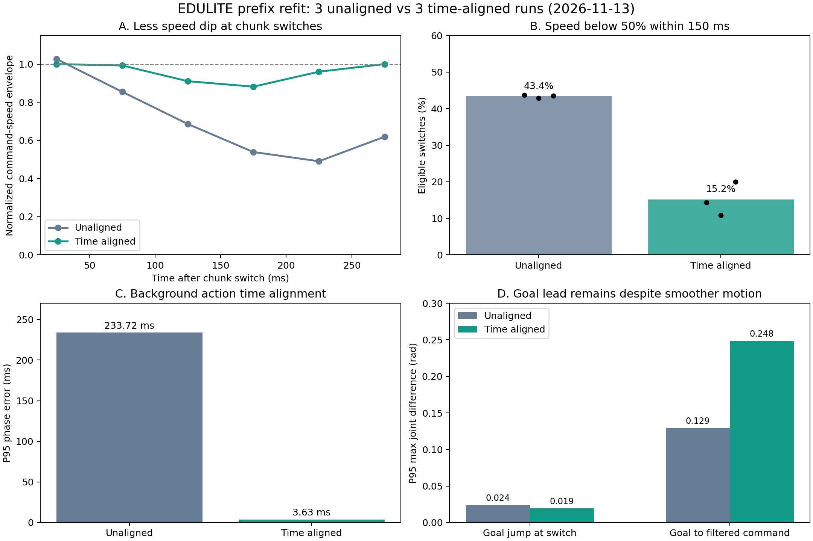

# EDULITE 时间对齐后三轮记录分析（2026-11-13）

> 已合并至[真机部署调整总报告](EDULITE_DEPLOYMENT_COMPARISON_2026-11-13.md)，统一比较5种方案、15轮测试。本文件保留阶段记录，当前结论与参数选择以总报告为准。

时间对齐后的记录支持“chunk间顿挫明显减轻”的现场观感。最明显的变化是换块后的指令速度下降减少，
推理速度基本相同。位置衔接也略有改善，但模型目标领先滤波发送位置的距离增大，仍需观察放置精度和任务成功率。

## 对照数据与统计口径

路径均相对于 `robot/edulite_a3_vla/`：

- 旧版：`inference_outputs_multitask_adapolicy/run_20261113_172742`、`172827`、`172909`。
- 新版：`inference_outputs_multitask_adapolicy_aligned/run_20261113_183156`、`183234`、`183306`。

两组都是 `latest_ready + prefix_refit`，相同epoch50 checkpoint、into_box任务、instruction、归一化统计、
32步预测、16步接入窗口、预取8步、30Hz目标更新、100Hz控制、样条参数及安全参数。
各组内保存的settings完全一致；两组settings的差异只有新增的time_alignment开关及其镜像元数据。
新版还按照该开关刷新启动首块，不再执行等待数秒的preview轨迹，所以比较包含这项启动行为变化。

合并原始CSV计算分位数，不对三轮P95求平均。块级指标只取background，排除preview/startup_refresh。
旧版224个后台块、2917次目标更新；新版138个后台块、1832次目标更新。
新版运行记录分别18.94、20.56、22.04秒，旧版分别33.54、28.97、34.68秒。
全部是operator_stop，日志没有任务成功标注，运行时长不能作为任务完成时间或效率结论。

## 主要结果

| 指标 | 未对齐三轮 | 时间对齐三轮 |
|---|---:|---:|
| 换块后150ms内指令速度降至前基准一半以下 | 79/182，43.4% | 17/112，15.2% |
| 换块后150～200ms的指令速度/换块前速度，中位数 | 0.539 | 0.882 |
| 换块后200～250ms的指令速度/换块前速度，中位数 | 0.491 | 0.960 |
| 后台目标时间相位误差P95 | 233.72ms | 3.63ms |
| 输出目标边界跳变P95 | 0.023757rad | 0.019407rad |
| 每块最大目标步长P95，含边界 | 0.048788rad | 0.042692rad |
| 有效边界前后目标方向折返 | 183/191，95.8% | 97/119，81.5% |
| 后台推理P50 / P95 | 180.16 / 206.27ms | 184.32 / 208.03ms |
| 块首原状态观测年龄P50 / P95 | 203.17 / 236.20ms | 204.09 / 237.49ms |
| 样条计算P95 | 0.776ms | 0.755ms |
| 正式动作执行期间指令超时 / 队列等待 / 调度重置 | 0 / 0 / 0 | 0 / 0 / 0 |
| 后台样条回退 | 3/224，1.34% | 5/138，3.62% |
| 跟踪误差P95：滤波发送位置与反馈 | 0.017460rad | 0.016573rad |
| 模型安全目标与滤波发送位置之差P95 | 0.129260rad | 0.248196rad |

换块后明显减速的事件比例相对下降约65%，目标边界跳变P95下降约18.3%。
时间对齐补偿的是预测的执行索引，原始观测仍有约200ms年龄，并没有因切片变成新观测。
因此改进不能归因于模型推理变快；记录与“避免重复执行过时前缀、减轻重规划后的减速”这一解释一致。
本次不是相同初始状态的随机配对实验，不能独立证明所有改善都由时间对齐造成。

### 换块速度的统计方法

沿用上次分析：从100Hz控制日志取 `max_command_velocity_rad_s`，即六关节指令速度绝对值的最大值。
取边界前100～20ms的均值作为每个事件基准，只保留该基准大于0.05rad/s的运动边界。
边界后按50ms分箱，每个事件归一化后取中位数；另统计前150ms最低速度是否低于基准一半。
分析边界沿用先前脚本的范围：排除最前3个、最后6个动作索引处的边界。
这是控制器计算的指令速度包络，不是电机实测速度，也不是物理jerk指标。自然转弯也可能触发减速。

| 边界后时段 | 未对齐 | 时间对齐 |
|---|---:|---:|
| 0～50ms | 1.027 | 1.000 |
| 50～100ms | 0.855 | 0.993 |
| 100～150ms | 0.686 | 0.911 |
| 150～200ms | 0.539 | 0.882 |
| 200～250ms | 0.491 | 0.960 |
| 250～300ms | 0.619 | 1.000 |

考虑到两组停止时间不同，额外只统计各轮正式动作开始后前18秒的边界：
减速过半事件比例仍从57/112=50.9%降至14/102=13.7%；有效目标折返比例从98.2%降至80.0%。
因此观察到的趋势也存在于相同长度的早期窗口，不能仅用新旧记录末尾停留时长不同解释。

### 新版三轮分别如何

| 轮次 | 后台块 | 后台时间相位误差P95 | 边界跳变P95 | 减速过半事件 | 安全警告目标 / 回退块 |
|---|---:|---:|---:|---:|---:|
| 18:31:56 | 42 | 3.56ms | 0.019407rad | 5/35，14.3% | 0 / 1 |
| 18:32:34 | 46 | 3.57ms | 0.025211rad | 4/37，10.8% | 0 / 0 |
| 18:33:06 | 50 | 3.65ms | 0.018473rad | 8/40，20.0% | 42 / 4 |

旧版三轮减速过半事件分别43.8%、42.9%、43.5%，新版三轮均更低。
并非所有位置指标每轮都变好，例如第二轮边界跳变P95略大于旧版第二轮。

## 时间对齐是否按预期工作

包含3个startup_refresh在内，共141个已接入动作块，起始索引分布如下：

| 起始索引（从0计） | 4 | 5 | 6 | 7 | 8 |
|---|---:|---:|---:|---:|---:|
| 块数 | 1 | 13 | 110 | 15 | 2 |

典型窗口为原预测的索引6～21或7～22，均保留完整16步，最大起始索引8低于允许上限16。
没有过期拒绝、队列断供或调度重置。排除最后被停止截断的后台块后，实际取出的目标数中位数仍为13，P95为14，
说明旧队列被就绪结果替换的节奏基本一致，没有变成另一种执行频率。

后台1793次目标交付的时间相位误差P95为3.63ms，最大8.12ms，全部在一个33.33ms动作周期内。
包含启动首块的全部1832次目标交付，P95为4.37ms，最大33.81ms；最大值出现在第三轮startup_refresh块。
所以不能声称每一个目标都严格满足一个周期以内。
这里衡量的是目标交给控制器的时间，不是电机到位时间，也不保证图像与关节反馈采样同步。

旧版没有保存alignment_phase_error_s，表中的旧版相位误差由同一口径重建：
`command_mono_s - (observation_mono_s + (chunk_actions_selected - 1)/30)`。
新版在该式中加上aligned_start_index，重建值与已有相位误差日志逐条核对一致。

## 两处需要区分的现象

### 启动前的17个超时周期不代表执行途中断供

新版每轮runtime_summary都记录17个model_command_timeout_cycles，合计51个。
逐条对齐控制时间戳后，它们全部位于第一次模型目标发送之前约164～166ms的首块刷新保持阶段；
第一次发目标到最后一次发目标之间均为0。这是当前摘要把启动刷新期间的保持控制也统计进来的结果。
不要把摘要的17解释成正式执行过程中的17次等待推理，更不是17秒。

顺便修正上一份报告的总量表述：旧版17:28:27的原始摘要也有1个启动前超时周期；正式动作执行期间为0。

### 第三轮末尾的42次警告是L2训练范围裁剪

第三轮execution_trace约20.60～22.03秒，42个目标出现警告，占该轮657次目标更新的6.39%，
占新版合并1832次目标更新的2.29%。对应差异只出现在L2：

- 训练统计L2最小值为0.081901118rad，safe_target保持在该下界附近。
- 模型选择的目标出现0.073730469rad，最小约0.065917969rad，随后被裁剪回下界。
- 最大裁剪差为0.015983rad（约0.916度）；目标最大相邻变化约0.04505rad，小于配置的最小步长阈值0.08rad。
- 其余关节目标未出现这类差异，夹爪没有越过[0,1]，与训练范围裁剪一致，未见步长限幅触发的证据。

第三轮4个样条回退均为最后4个后台块。已有fallback_if_worse保护在候选边界或最大步长更差时退回原始窗口，
回退后仍由控制器执行范围与步长保护。当前没有依据为消除这些警告而放宽训练范围或机械限制。

## 仍未解决的部分与配置建议

时间对齐后模型safe_target与filtered_command的差P95由0.12926增至0.24820rad（约14.22度），
最大0.30929rad。这不是following_error；后者比较发送位置与反馈，P95仍只有0.01657rad。
二者不能混用，也不能把0.30929直接同max_follow_error_rad=0.3比较而认定触发保护。

这说明时间对齐后的模型目标与实际发送轨迹仍有明显距离；持续运动时目标领先和原有滤波、速度/加速度限制都可能参与，
仅靠这批记录不能分离其贡献。对齐后的原始首目标到当前发送位置的距离P95约0.10530rad，
局部样条处理后的同类距离P95约0.26489rad，提示贴合历史模型目标的局部拟合仍不等于贴合当前发送位置。
目标边界方向折返也还有81.5%，因此没有证据说已实现严格速度连续。

目前建议保留 `config.real_multitask_adapolicy_aligned.yaml` 作为下一轮配置，保持30/100Hz、32/16、预取8、
history_actions=2、control_points=8、history_weight=4、refit_regularization=0.05、filter_omega=10和现有限速不变。
先补充同样布局下的两任务成功/失败、抓取/放置精度与夹爪开合时机记录，再决定是否需要进一步处理目标领先或速度边界。
本次结果尚不足以要求增加速度桥接，也没有显示必须调大预取阈值。



图B黑点代表各轮比例；各chunk边界不是独立任务试验，没有据此做统计显著性或成功率推断。

完整合并数据：[JSON](analysis/edulite_time_alignment_comparison_2026-11-13.json)。
可复算脚本：[analyze_edulite_time_alignment.py](analysis/analyze_edulite_time_alignment.py)。

```bash
conda activate edulite_deploy
cd /home/lab347-no10/Tianyi/LiLa-WAM
MPLCONFIGDIR=/tmp/edulite_alignment_mpl python docs/analysis/analyze_edulite_time_alignment.py --plot
```

本次只离线读取日志、生成报告与图表；没有修改部署配置、运行控制代码或连接机械臂。
