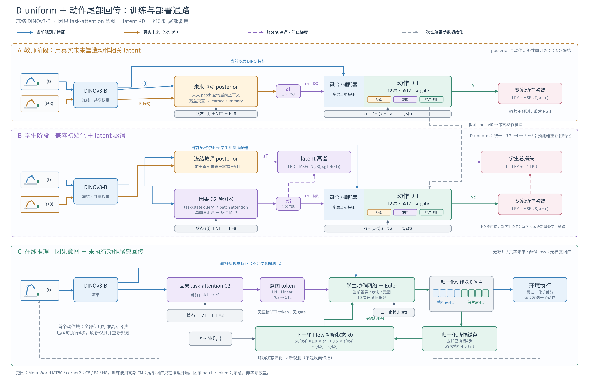

# D-uniform＋动作尾部回传：结构图说明

制作日期：2026-11-11。按本地实现绘制，不包含尚未开展的动作响应蒸馏。

## 文件与用途

| 版本 | 可编辑矢量图 | 矢量 PDF | 高清 PNG |
|---|---|---|---|
| 中文说明版 | [SVG](d_uniform_tail_overview_zh.svg) | [PDF](d_uniform_tail_overview_zh.pdf) | [PNG](d_uniform_tail_overview_zh.png) |
| 英文展示版 | [SVG](d_uniform_tail_overview_en.svg) | [PDF](d_uniform_tail_overview_en.pdf) | [PNG](d_uniform_tail_overview_en.png) |

PNG 尺寸为4800×3080。SVG 保留文字，便于后续调整；跨电脑编辑中文SVG需要安装相应中文字体，PDF适合直接插入排版软件。图中的相机/机械臂小图为矢量示意，不是真实仿真截图。token图标数量为示意，不用于表达真实序列长度。



## A：教师训练

冻结的 DINOv3-B 编码当前图像与未来图像。future-driven posterior 接收当前/未来 patch、状态、VTT和未来跨度，输出单个768维教师latent。

posterior内部用未来patch作为查询读取当前上下文，再做残差交互和可学习summary汇总。教师latent经LayerNorm和线性投影进入动作网络。当前多层视觉特征另有独立的融合/适配器通路，不必先经过posterior压缩。

教师posterior与教师动作网络由专家动作Flow Matching损失共同训练；posterior接口不接收专家动作、Flow时间或动作噪声。没有未来RGB图像重建。

## B：D-uniform学生训练

- 从原教师epoch40继承兼容动作模块，包括特征融合/视觉适配器、意图投影、DiT、动作输入输出等；不是只复制DiT。
- 因果task-attention池化器和意图预测器重新初始化。没有使用新近加入的late-pool变体。
- 学生只能基于当前图像、当前状态、VTT和跨度预测latent；真实未来只能进入冻结的教师posterior。
- 教师posterior提供停止梯度的latent目标。学生总损失为：

```text
L_FM = MSE(vS, a − ε)
L_KD = MSE(fixed_LN(zS), stopgrad(fixed_LN(zT)))
L = L_FM + 0.1 L_KD
```

KD直接更新学生的意图池化器和预测器，不直接更新DiT；动作loss更新整条实际参与动作生成的学生通路。DINO始终冻结。

所有实际优化模块使用统一学习率2e-4→5e-5的余弦日程。按50轮日程训练，当前模型比较使用epoch40。图中灰色虚线表示一次性初始化，不表示每步重新复制参数，也不表示KD。

## C：在线推理与尾部回传

部署只需要冻结DINO和学生网络，不需要教师、未来图像或KD损失。VTT通过G2间接进入DiT，没有直接VTT token、标量gate或dense future-feature辅助预测模块。

当前配置为MT50 corner2、单帧状态、4维动作/状态、动作块8步、执行前4步、未来跨度8、10次Euler积分。G2每个新动作块计算一次，当前视觉/状态/意图在该次10步积分中复用。推理中的“10次速度场计算”不是10个环境step。

每次生成的归一化动作块会缓存。执行4步后，未执行的后4步对齐下一轮动作块的前4个位置：

```text
ε ~ N(0,I)
x0[0:4] = strength × previous_normalized_chunk[4:8] + sigma × ε[0:4]
x0[4:8] = ε[4:8]

本图参数：strength=1.0，sigma=0.5。
```

首个动作块没有历史缓存，因此所有位置都使用标准高斯噪声；后续生成的全部8个位置仍会经过10次Flow积分。尾部不是硬锁定动作，也不是新增条件token。缓存保留归一化值，发送环境前才反归一化并裁剪。

**回传是推理时动作尾部复用，不是梯度回传、OPD、响应蒸馏、动作先验R训练或B样条平滑。**D-uniform训练仍采用标准高斯源分布。绿色回路是动作缓存影响下一轮源分布；灰色大回路是环境执行后获得新观测。

## 对照的本地实现

- [D-uniform配置](../../metaworld_vla/configs/metaworld_mt50_easy_planwam_action_init_student_uniformlr.yaml)
- [实际训练run配置](../../checkpoints/student_action_init/metaworld_mt50_easy_planwam_action_init_student_uniformlr_seed0/config.yaml)
- [教师posterior与latent KD](../../models/planwam_g2.py)
- [task-attention、意图预测与DiT](../../models/vla_model_fm.py)
- [兼容参数初始化](../../metaworld_vla/planwam_transfer.py)
- [训练入口](../../metaworld_vla/train_planwam.py)
- [在线推理入口](../../metaworld_vla/eval.py)
- [尾部缓存及源分布实现](../../metaworld_vla/action_reuse.py)
- [tail测评协议](../../eval_result/planwam_comparison/action_init_student_uniformlr_ep40_tail_env1000_policy456.json)

本图不标成功率，避免把单run、单seed区间结果误画成普遍性能结论。仅新增绘图脚本与图文资产，没有修改模型、训练或测评代码。

## 重新生成

绘图脚本：[draw_d_uniform_tail.py](../../utils/figures/draw_d_uniform_tail.py)。使用Matplotlib原生矢量对象绘制，不需要启动模型或仿真。

```bash
cd /home/lab347-no10/Tianyi/LiLa-WAM
python utils/figures/draw_d_uniform_tail.py
```

如需更高PNG分辨率，追加`--dpi 300`。更新文字与布局后重新执行可同时更新中英SVG、PDF、PNG。

英文图注建议：

> Overview of D-uniform with action-tail feedback. A privileged teacher posterior learns an action-shaped latent from current and future visual features. A causal student inherits compatible action-network parameters and is trained with expert flow matching and normalized latent distillation using a uniform learning-rate schedule. At deployment, only current observations are used. The unexecuted normalized action tail is combined with Gaussian noise to initialize the overlapping positions of the next action chunk; remaining positions use standard Gaussian noise.
